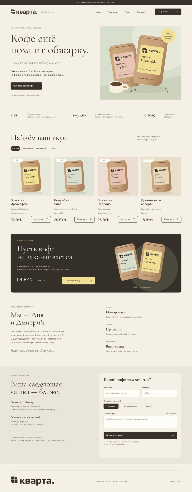
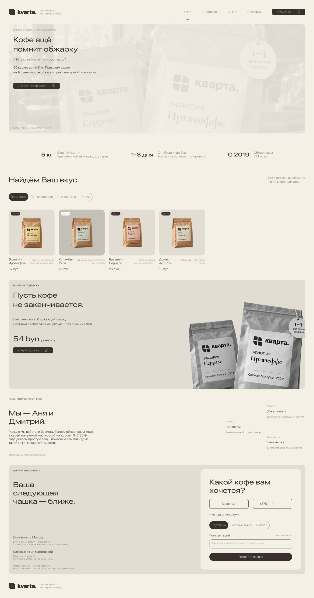

# Кварта

**Лендинг небольшой мастерской свежей обжарки кофе в Минске**

[**Открыть сайт ↗**](https://xtrasupra.github.io/kvarta-coffee/) · [Figma](https://www.figma.com/design/EtgnvPBaxsba3i3vIYSIl6/?node-id=0-1) · [Behance](https://www.behance.net/6e40370b) · [Telegram-бот](https://t.me/kvarta_applicationsbot)

`React` · `JavaScript` · `CSS` · `FastAPI` · `SQLite` · `Telegram Bot API`

Тестовое задание Junior Developer (AI-assisted) для VitAi World. Клиент вымышленный.

## Идея и моя роль

Я начал с концепции, сгенерированной через ChatGPT, и использовал её как отправную точку. Затем я переработал desktop-макет в Figma: уточнил сетку и отступы, пересобрал типографическую иерархию, уменьшил конкуренцию цветных элементов и выбрал более сдержанную подачу. Для мобильной версии я передал ИИ свой макет как референс и уточнял адаптив по промежуточным результатам.

Я выбрал стек, задавал поведение интерфейса, собирал проект в VSCodium по модулям, подключал компоненты и проверял результат в браузере. Значительная часть React/CSS, бэкенд, изображения и тесты подготовлены ИИ по моим запросам. После ручной сборки я поручил ИИ самостоятельно диагностировать и исправить публикацию. Поэтому я не представляю проект как полностью самостоятельно написанный код: мой вклад — дизайн, постановка задач, интеграция, проверка и управление итерациями.

<strong>01 — исходная концепция ИИ · 02 — моя переработка desktop-дизайна</strong>

<table>
<tr><th>01 · Концепция ChatGPT</th><th>02 · Моя переработка в Figma</th></tr>
<tr>
<td valign="top"></td>
<td valign="top"></td>
</tr>
</table>

## Что реализовано

- Адаптивные блоки свежести, каталога с ценами, подписки, истории мастерской, доставки и контактов. Карточки добавляют выбранный кофе в комментарий списком; подписка заменяет его своим шаблоном.
- Форма отправляет заявку в `POST /api/lead`. Белорусский номер проверяется в браузере и на сервере, ошибки объясняются рядом с полями, при сбое API введённые данные остаются в форме.
- SQLite хранит заявки и очередь Telegram. Проверка номера за последние 600 секунд и вставка выполняются одной транзакцией `BEGIN IMMEDIATE`, включая одновременные запросы. Для небольшого тестового проекта это проще отдельного сервера БД.
- Сохраняются UTM, идентификаторы рекламы, страница входа, текущая страница и referrer. Уведомления отправляются через [@kvarta_applicationsbot](https://t.me/kvarta_applicationsbot) с повторными попытками при сбое.
- Плавные состояния кнопок и карточек, движущиеся индикаторы навигации и фильтра, появление мобильного меню, прокрутка к форме и поддержка `prefers-reduced-motion`.

## Проверки и ограничения

Я привёл результаты фактических проверок, выполненных с ИИ: два одновременных запроса создали одну заявку, неверный номер получил HTTP 422, UTM сохранились, Telegram подтвердил доставку. После перезапуска API заявка осталась в базе. Два регрессионных теста формы и production-сборка прошли.

**Lighthouse Mobile: 83 / 100 / 100 / 100** — Performance / Accessibility / Best Practices / SEO. [HTML-отчёт](docs/reports/lighthouse-mobile.report.html), [JSON](docs/reports/lighthouse-mobile.report.json), [условия замера](docs/testing.md).

При публикации обнаружились ошибки подключения: локальный `.env.local` перекрывал production-адрес API, а CORS не разрешал GitHub Pages. Ещё проверка длинного комментария использовала переменную до объявления. Диагностику и исправления выполнил ИИ после моего сообщения о неработающей форме; разбор я сохранил в [описании процесса](docs/process.md).

В следующей итерации я оптимизировал бы тяжёлые изображения и LCP, доработал шрифтовую поставку и добавил Open Graph. SF Pro сейчас используется только при локальной доступности, иначе работает системный fallback. Для реальной нагрузки я пересмотрел бы хранение и хостинг: ASGI на PythonAnywhere экспериментальный, бесплатное приложение требует продления. Исходный необработанный экспорт переписки я не публикую; ниже доступны реальные выбранные сообщения с явно обозначенной редактурой и удалением секретов.

## Материалы для проверки

| Материал | Ссылка |
| --- | --- |
| Живой сайт | [xtrasupra.github.io/kvarta-coffee](https://xtrasupra.github.io/kvarta-coffee/) |
| Репозиторий и история | [GitHub](https://github.com/xtrasupra/kvarta-coffee) · [коммиты](https://github.com/xtrasupra/kvarta-coffee/commits/main/) |
| Макет и портфолио | [Figma](https://www.figma.com/design/EtgnvPBaxsba3i3vIYSIl6/?node-id=0-1) · [Behance](https://www.behance.net/6e40370b) |
| Работа с ИИ | [Выдержки реального диалога](docs/ai-dialogue.md) · [JSON с исходными датами](docs/ai-dialogue-excerpts.json) |
| Технические решения | [Что я делал и где использовал ИИ](docs/process.md) |
| Адаптив, Lighthouse, API | [Проверки и скриншоты](docs/testing.md) |
| Запуск и публикация | [Инструкция](docs/setup.md) |
| Telegram | [@kvarta_applicationsbot](https://t.me/kvarta_applicationsbot) — уведомления, адресат задан на сервере |
| Проверка API | [/api/health](https://xtrasupra.pythonanywhere.com/api/health) |
| Тестовое задание | [Страница](https://tz.vitai.world/) · [PDF](https://tz.vitai.world/kvarta-brief.pdf) |
| Сообщение для отправки | [Подготовленный текст письма](docs/submission-message.md) |
