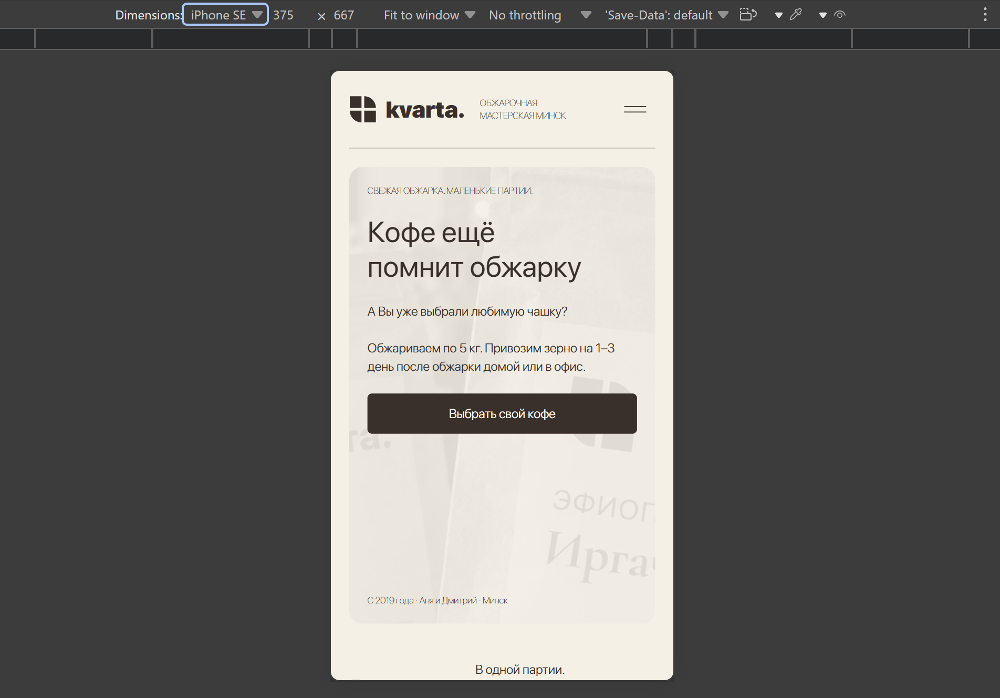
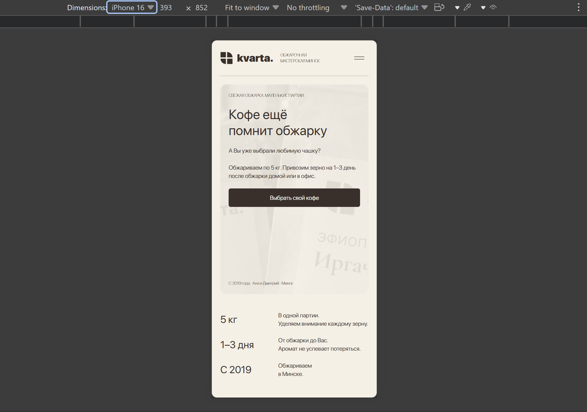
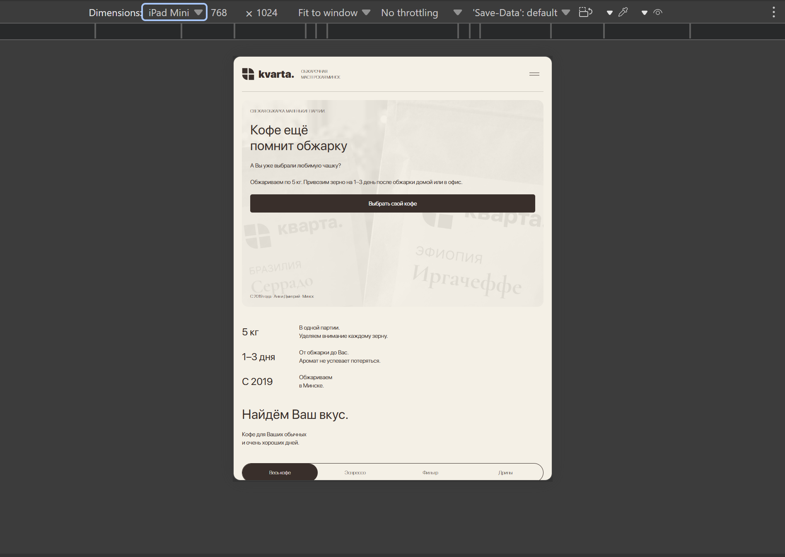
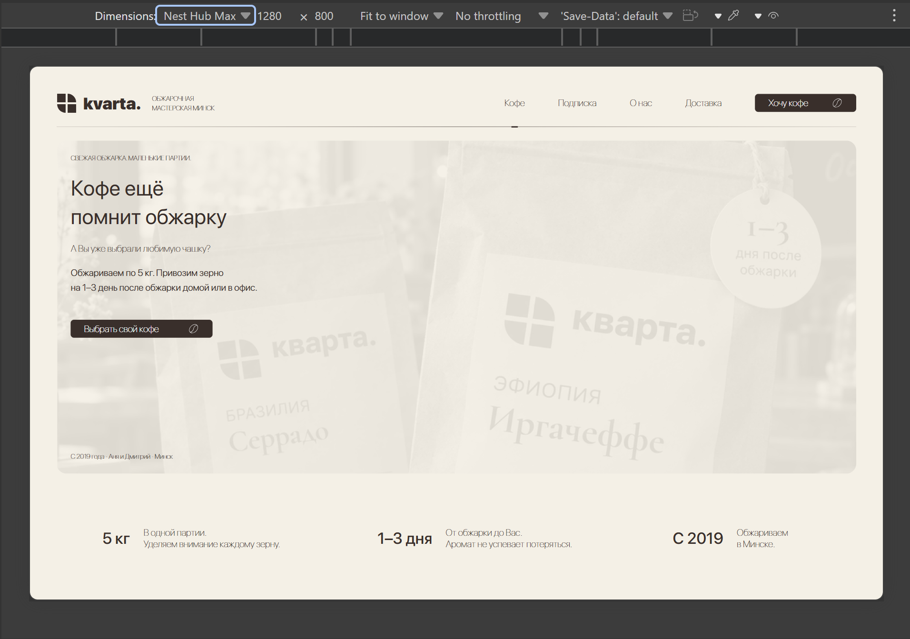

# Как я проверял проект

[Сайт](https://xtrasupra.github.io/kvarta-coffee/) · [API](https://xtrasupra.pythonanywhere.com/api/health) · [README](../README.md)

Я разделяю предоставленные мной снимки адаптива, автоматический Lighthouse и фактические проверки API. Это разные виды проверки; снимок режима устройства не является Lighthouse-отчётом.

## Настоящий Lighthouse Mobile

Я поручил ИИ выполнить аудит опубликованной страницы. Отчёт получен Lighthouse **13.5.0**, 17.10.2026 в **03:57 МСК** (00:57 UTC), через отдельный headless-процесс Microsoft Edge 155. Оценки в HTML/JSON не редактировались.

| Категория | Баллы |
| --- | ---: |
| Performance | **83** |
| Accessibility | **100** |
| Best Practices | **100** |
| SEO | **100** |

| Метрика | Результат |
| --- | ---: |
| First Contentful Paint | 0,8 с |
| Largest Contentful Paint | 4,5 с |
| Total Blocking Time | 110 мс |
| Cumulative Layout Shift | 0,001 |
| Speed Index | 2,0 с |

[HTML-отчёт](reports/lighthouse-mobile.report.html) · [Исходный JSON](reports/lighthouse-mobile.report.json)

GitHub показывает HTML как исходный файл: для интерактивного просмотра его нужно скачать и открыть в браузере. Это один лабораторный прогон, не среднее нескольких запусков и не полевые данные пользователей. Настройки: mobile, viewport 412 × 823, DPR 1,75, simulated throttling, CPU slowdown ×4, RTT 150 мс и throughput 1638,4 Кбит/с. Предупреждений запуска и runtime error в отчёте нет. 100 баллов по автоматической Accessibility не означают, что я провёл полный ручной аудит доступности.

В отчёте остались замечания к доставке и размерам изображений, обнаружению LCP-ресурса, неиспользуемому JavaScript и времени кеширования. Также есть диагностические замечания к reflow и доступным именам отдельных элементов. Поэтому в следующей итерации я проверил бы WebP/AVIF, адаптивные размеры изображений и загрузку первого экрана; результат 83 не заменял на обещанные «идеальные» баллы.

Для повторения можно использовать официальный [Lighthouse CLI](https://github.com/GoogleChrome/lighthouse):

```powershell
$env:CHROME_PATH = 'C:\Program Files (x86)\Microsoft\Edge\Application\msedge.exe'
npx lighthouse https://xtrasupra.github.io/kvarta-coffee/ --chrome-flags="--headless=new" --output=html --output=json --output-path=./lighthouse-mobile
```

## Снимки адаптива из DevTools

Я предоставил четыре снимка с выбранными профилями устройств. На них видна только часть страницы. Они не подтверждают проверку всего сайта на физических устройствах, реальную скорость загрузки или автоматическое отсутствие горизонтального переполнения.

| Профиль DevTools | Viewport | Снимок |
| --- | --- | --- |
| iPhone SE | 375 × 667 | [Открыть](images/responsive-375-iphone-se.png) |
| iPhone 16 | 393 × 852 | [Открыть](images/responsive-393-iphone-16.png) |
| iPad Mini | 768 × 1024 | [Открыть](images/responsive-768-ipad-mini.png) |
| Nest Hub Max | 1280 × 800 | [Открыть](images/responsive-1280-nest-hub-max.png) |

<details>
<summary>Посмотреть снимки мобильных размеров</summary>





</details>

<details>
<summary>Посмотреть снимки планшета и широкого экрана</summary>





</details>

## Проверки формы и сервера

После моего сообщения об ошибке публикации ИИ выполнил следующие проверки реального API. Я привожу результат как проверку с помощью ИИ, а не как полностью выполненную мной вручную.

| Сценарий | Результат |
| --- | --- |
| `GET /api/health` | HTTP 200, `ok: true` |
| OPTIONS с `Origin: https://xtrasupra.github.io` | HTTP 200 и соответствующий `Access-Control-Allow-Origin` |
| Адрес API в опубликованном JS | HTTPS PythonAnywhere; прежнего `127.0.0.1:8000` нет |
| Два одновременных POST одного нормализованного номера | Одна новая заявка и один ответ `duplicate: true` |
| Неверный телефон | HTTP 422 |
| Источник рекламы | `utm_source`, `utm_campaign`, `utm_content` сохранены в SQLite |
| Telegram | Для помеченной тестовой заявки сохранено подтверждение отправки, одна попытка, ошибки нет |
| Перезапуск приложения и повторный POST в пределах окна | Заявка сохранилась, повтор распознан как дубль, второго уведомления не создано |

[Машиночитаемый результат проверки API и базы](reports/api-verification.json)

В Telegram отправлялась явно помеченная тестовая заявка с примером номера, без запроса на реальный звонок. Проверки не обращались к настоящим клиентам.

Два регрессионных теста `LeadForm.test.js` проходят: длинный комментарий после добавления кофе показывает ошибку без API-запроса; двойная отправка вызывает API один раз и показывает успех только после ответа. Production-сборка также проходит.

```powershell
cd frontend
npm test -- --watchAll=false --runInBand
npm run build
```

При прошлой проверке управляющий браузерный инструмент завершился таймаутом. Эту попытку я не учитываю как успешное ручное прохождение формы. В текущих материалах отдельно есть предоставленные мной снимки и успешно завершённый headless-аудит Lighthouse; они не подменяют полную проверку заказа человеком от начала до конца.
